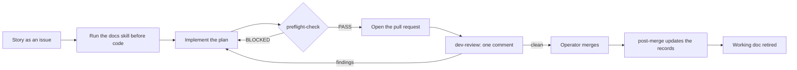

# checkrein

Reins and checks for coding agents.

checkrein is a workflow for coding agents: a hub document, a small set of living documents, nine skills, one manifest and a set of mechanical checks. It was extracted from a method a solo developer ran for hundreds of pull requests on a production app, then generalized so any project on any stack can adopt it. It is MIT licensed and free.

## Why this works

A coding agent does not fail at random. It fails in a handful of predictable ways, and it repeats them, because it starts every session without memory of the last one. That predictability is the opening: if a failure is predictable, a counter can be placed at the exact moment the failure would happen. The counter does not need to be clever. It needs to be cheap and it needs to run at the right time.

checkrein is built on six ideas.

**One record per kind of knowledge.** Why the system is built this way lives in the architecture record. What the rules are lives in the business rules record. What exists right now lives in the state document. What went wrong lives in the corrections log. What changed lives in the changelog. Each fact has one home, and every other document links to it instead of restating it, because a restated fact is a second copy that drifts the moment the first one changes. These documents are the memory the agent does not carry between sessions.

**Every procedure reads before it acts and writes after.** A skill that writes code reads the corrections log first. A skill that reviews code reads the settled decisions first. A skill that runs after a merge writes what was learned back into the records. The loop closes on itself: what one session learns, the next session reads. A session that never reads the log reintroduces the bug last week's session fixed.

**Checks beat prose.** A rule written in a document is advice. A rule a script enforces is a fact. Wherever a rule can be checked mechanically, checkrein checks it: the corrections-log heading grammar, the state document's shape, working-doc names, cited paths that must exist. A corrections heading written without its tag drops out of the grep index and the rule is never found again; the check fails it on the next run. Where a rule cannot be checked, the hub states it once and every skill points back to that one statement, so there is never a second wording to disagree with.

**Reading is scaled to the change.** The `docs` skill has a tier gate. A prose edit reads almost nothing; a surgical code edit reads a little; new surface (a new module, endpoint, model or library) reads the full fan-out. Discipline that costs the same on a typo as on a new subsystem gets skipped. Discipline that costs almost nothing on small work and pays on large work gets kept.

**The templates carry their own instructions.** Every document the kit installs opens with a contract: what belongs in it, what never belongs in it, who writes it, and how agents read it. Below the contract, filler guidance names each section's purpose and gives a neutral example. An empty template produces a document nobody knows how to maintain, and within a few weeks it becomes a dumping ground that agents stop trusting. A document that says what it is for stays itself, because every agent that edits it reads the contract first. The reference-documentation tree works the same way: each folder is fronted by an `_INDEX.md` that tells the agent which file to open for which question, so a vendored library doc is read in the right place instead of in full or not at all. The kit keeps these templates and their filler current: when a skill starts reading or writing a section, the template and its guidance change in the same release.

**The operator stays in charge.** Merges, decisions, production access and anything irreversible belong to the operator, the human who owns the repository. Skills ask about those; they do not act on them. An agent that is never allowed to merge cannot merge the wrong thing.

### Each failure, and the counter that stops it

| Failure | What it looks like | The counter |
|---|---|---|
| Hallucinated API | The agent calls a function signature the library never had, because it looked plausible. | The `docs` skill runs before any code. It reads the vendored `_INDEX.md` for the library first and opens the file the index points to, so the agent works from the pinned version's real API instead of memory. |
| The repeated mistake | A bug fixed last month comes back in a new file, written by an agent that never saw the fix. | Before any code, the agent searches the corrections log's tagged headings (`### Pattern [domain]: ...`), scans every heading line, and pulls the matching entries by line number. A rule in the log is a hard constraint. |
| The relitigated decision | A reviewer flags a shape that was chosen on purpose three pull requests ago, and the operator pays for the same decision twice. | Part 4 of the state document (accepted debt and settled decisions) is read before any finding is written. An observation that matches a Part 4 row is not a finding; reopening one takes new evidence the row does not already contain. |
| Scope creep | A ticket about search also refactors the settings page because it "looked wrong". | Every observation about code the pull request did not touch ends in one of three dispositions: **Fold** (fix it now, only if certain, small and inside code the PR already changes), **Record** (one row in Part 4, or a rule in the business rules or architecture record), or **Drop** (one line in the review saying why). Nothing else. |
| Comment essays | A forty-line comment defends a clever mechanism to future reviewers. | Comment discipline treats a long comment as a symptom. The detail moves to its home document (behavior to business rules, rationale to architecture, anti-patterns to the corrections log) before the comment is shortened, and the code keeps only what it cannot express itself. |

### The honest limit

Tier 1 is text and checks. Text does not stop an agent that ignores it. The adopter check verifies the records after the fact; it cannot see whether an agent read the corrections log before editing, or whether it opened a folder it was told to leave alone.

That is still worth a great deal, for two reasons. First, the agents in common use are cooperative: they read the instruction files their harness loads and they follow procedures they are given. The failures above happen because the right information was not in front of the agent at the right moment, not because the agent was defiant, and putting the information in front of it is most of the fix. Second, the checks catch the drift that remains. A document that slides out of shape fails the next run of the check, so the records stay trustworthy enough to keep being read.

Enforcement at the moment an agent acts is the next tier. The roadmap below describes hooks that deny or ask before a tool call runs, for the one harness that exposes them, with git hooks and CI as the fallback elsewhere.

## The loop

One ticket, start to finish:

1. **Story.** `github-story-writer` turns a spec or plan into a GitHub issue with acceptance criteria, verification steps, the corrections warnings that apply, and the governing rules. A larger piece of work also gets a working doc: `plan - <descriptor>.md` in the working docs folder.
2. **Docs before code.** The implementing agent runs `docs`, which applies the tier gate, the corrections check and the Governing-Docs Check, then follows the plan task by task.
3. **Preflight before the pull request.** `preflight-check` runs the manifest's commands verbatim, scans the changed files against the corrections log, and ends in PASS or BLOCKED. No pull request until PASS.
4. **One consolidated review.** `dev-review` posts a single review comment per round. Every finding is classified, carries a confidence and a source, and clears the confidence floor. Later rounds verify fixes and widen nothing.
5. **The operator merges.** Always the operator, never the agent.
6. **Post-merge.** When the operator asks, `post-merge` closes the issue with completion notes, appends corrections entries and a changelog entry, moves the state document's currency marker, and retires the working doc.



`structured-debugging` governs any fix along the way, and `package-upgrade` governs any dependency change.

## Requirements

- Node 20 or newer, for the adopter check.
- git.
- A repository hosted on GitHub.
- The `gh` CLI, installed and authenticated, for the issue, pull request and review operations in `github-story-writer`, `dev-review` and `post-merge`.

The manifest's `project.tracker` is `github`, the only supported value in tier 1.

## Install

### Claude Code

Add the marketplace, then install the plugin:

```
claude plugin marketplace add a2zarslaan/checkrein
claude plugin install checkrein@checkrein
```

On recent builds, one step does both:

```
claude plugin install checkrein --marketplace a2zarslaan/checkrein
```

Inside a session:

```
/plugin marketplace add a2zarslaan/checkrein
/plugin install checkrein@checkrein
```

To try a local checkout without installing it, start Claude Code with the folder as a plugin, and run `/reload-plugins` after each edit:

```
claude --plugin-dir /path/to/checkrein
```

Once installed, the skills run by name, or explicitly as `/checkrein:<skill>`, for example:

```
/checkrein:init
/checkrein:preflight-check
```

### Other harnesses

checkrein is also a plain folder. Clone the whole checkrein repository and keep the clone, then either point your harness's skills location at the clone's `skills/` folder, or copy the skills elsewhere and run the `init` skill, giving it the clone's path when it asks for the checkrein folder. `init` needs the clone because it copies `templates/` and `scripts/checkrein-check.mjs` from it; a `skills/` folder copied on its own does not carry them. You can also copy the contents of `templates/` and `scripts/checkrein-check.mjs` into your repository root by hand.

The hub is `AGENTS.md`. Codex, Cursor and Copilot read `AGENTS.md`; Gemini CLI reads it through its context-file setting. Claude Code reads `AGENTS.md` natively from version 2.1.277, only when no `CLAUDE.md` exists in the directory or its parents, unless the operator sets the instruction-files option to read both. For that reason `init` also installs a `CLAUDE.md` whose one import line, `@AGENTS.md`, loads the hub even where a `CLAUDE.md` already exists.

## Set up a repository

From the repository root, run the `init` skill (in Claude Code, ask for it by name: "set up checkrein in this repo").

It copies, never overwriting an existing file:

- `templates/project-documentation/` to `project-documentation/`
- `templates/reference-documentation/` to `reference-documentation/`
- `templates/AGENTS.md` to `AGENTS.md` (if a hub already exists, it writes `AGENTS.checkrein.md` and appends a pointer section for you to merge)
- `templates/CLAUDE.md` to `CLAUDE.md` (if one exists, it appends the import line instead)
- `templates/checkrein.json` to `checkrein.json`
- `scripts/checkrein-check.mjs` to `checkrein-check.mjs`

It infers what it can from your package and workspace configuration (project name, trunk branch, lint, typecheck, test, build and format commands) and shows where each value came from. Then it asks you, in one message, for what it cannot infer: your workspaces, your areas, any corrections domains to add, any protected trees, and a release branch if you promote trunk to one. It writes the manifest, then runs the check:

```
node checkrein-check.mjs
```

A fresh install prints `checkrein-check: OK (7 checks)`. `init` commits nothing; review the diff and commit it yourself. Then fill in the templates, starting with the project brief, replacing each guidance line with your own text and keeping the headings.

## What is in your repository after init

### The documents

| Document | Purpose | Maintained by |
|---|---|---|
| `AGENTS.md` | The hub: a navigation map of where each kind of knowledge lives and which skill runs when. Holds no content a living document owns. | The operator |
| `CLAUDE.md` | One import line that loads the hub in Claude Code, plus a short Claude Code note. | The operator |
| `checkrein.json` | The manifest: every project-specific path, command, workspace and vocabulary. | `init` writes it once; the operator edits it after |
| `project-documentation/project-brief.md` | What the product is, who it serves, priorities, constraints, non-goals, glossary. | The operator |
| `project-documentation/architecture.md` | Why the system is built this way: decisions, mechanisms, revisit conditions. | Whoever makes the decision, in the same change; `post-merge` cross-checks it |
| `project-documentation/business-rules.md` | What the system does: lifecycles, cascades, gating, calculations. | The operator; `post-merge` cross-checks it |
| `project-documentation/corrections-log.md` | Anti-patterns as rules, indexed by tagged headings, newest first, append-only. | `post-merge` |
| `project-documentation/current-project-state.md` | What exists now, in four parts: structural inventory, delta log, open gaps, accepted debt and settled decisions. | `post-merge`, on every run |
| `project-documentation/CHANGELOG.md` | What changed, one section per merged pull request. | `post-merge` |
| `project-documentation/temp/` | Working docs: `plan - <descriptor>.md` and `audit - <descriptor>.md`, disposable by design. | Created when work starts; retired by `post-merge` |
| `project-documentation/runbooks/` | Operational procedures: deploy, rollback, setup. | The operator |
| `reference-documentation/` | Vendored library and pattern docs, read-only, each folder fronted by an `_INDEX.md`. Ships with a placeholder example folder showing the shape. | The operator; agents may edit only the `_INDEX.md` files |

Each template's opening comment is its contract. Keep it: it is what tells the next agent what the document is for. The check ignores HTML comments, so the contract costs nothing at check time.

Keep both folders even while they are thin. An empty `reference-documentation/` with its root `_INDEX.md` still tells every agent where vendored docs would be, so the first library you vendor lands in the right place with an index in front of it. A nested `CLAUDE.md` in that tree reminds Claude Code, on every read beneath it, that nothing there is a project instruction.

### The manifest

| Key | What it holds |
|---|---|
| `checkrein.manifest_version` | The manifest format version (1). |
| `project` | Name, one-line description, and the tracker (`github`). |
| `vcs` | The trunk pull requests target, and an optional release branch. |
| `commands` | Lint, typecheck, test, build and format-check commands, run verbatim by `preflight-check`; an empty one is reported as not configured. |
| `paths` | Where each living document and folder lives, relative to the repository root. |
| `workspaces` | The independently buildable parts of the repository, each a name and a root. |
| `protected_trees` | Folders an agent never reads as guidance, such as an archive of retired code. |
| `secret_globs` | Files an agent never reads or edits. |
| `domains` | The closed vocabulary for corrections-log tags; `process` is always present. |
| `areas` | The vocabulary for issue, pull request and branch names. |
| `review.confidence_floor` | The minimum confidence (0 to 100) a review finding needs to be posted. |

Skills cite manifest values as `{{ref:<dotted.key>}}` tokens and resolve them in their first step. Nothing project-specific is written into a skill. `skills/init/references/manifest-fields.md` describes every key in full.

## Skills

| Skill | Runs when | Produces |
|---|---|---|
| `init` | Once per repository, when there is no manifest yet | The templates, the manifest and the check script in the repository root, nothing overwritten, then a check run |
| `docs` | Before writing or changing any code, proposing an approach, or attempting a fix | A file resolution table, the tier and why, the indexes and files read, the corrections rules that apply, the governing sections read |
| `dev-code` | Only when the operator asks for it | A posture for the task: think before coding, simplicity first, surgical changes, goal-driven execution |
| `github-story-writer` | When the operator wants a spec or plan broken into work | GitHub issues written like stories, grounded in the state document; a batch is shown for confirmation before it is created |
| `preflight-check` | Before every pull request | One report ending in PASS, or BLOCKED with a numbered list of critical failures |
| `dev-review` | Right after a pull request is created, and for each re-review | One consolidated review comment with classified, sourced findings above the confidence floor |
| `structured-debugging` | When a cause is not obvious, and always after a first fix fails | Triage, observation, documentation and diagnosis blocks, then a fix proposal; options for the operator on an Approach Limitation |
| `post-merge` | Only when the operator asks, after one or more merges | Issue completion notes and closure, corrections and changelog entries, an updated state document, the working doc retired |
| `package-upgrade` | Before any dependency version change, patch bumps included | A migration plan the operator approves, an exact-pinned upgrade with every pin location bumped in one commit, verification, a summary |

Every skill that reads project files begins with Step 0: read `checkrein.json`, substitute its tokens, and stop with a message to run `init` if it is missing.

## Mechanical checks

### For adopters: `checkrein-check.mjs`

One zero-dependency file, copied to your repository root by `init`. Run it with `node checkrein-check.mjs`; `--root <dir>` checks another folder and `--quiet` prints findings only. It exits 1 on any failure and 0 otherwise, with one line per finding prefixed by the check's name. It runs seven checks, in order:

1. **manifest**: `checkrein.json` parses, has every key and no unknown ones, `manifest_version` is 1, the trunk is named, every path exists (folders written with a trailing slash), `domains` includes `process`, every workspace has a unique name and a root that exists, and the confidence floor is an integer from 0 to 100.
2. **corrections**: every rule heading follows `### Pattern [<domains>]: <sentence>` or `### Convention [<domains>]: <sentence>`, every tag is in `domains`, and every entry carries its four fields in order: What went wrong, Correct approach, Rule, Files affected.
3. **working-docs**: every markdown file in the working docs folder is named `plan - <descriptor>.md` or `audit - <descriptor>.md` (a README is allowed).
4. **state-doc**: the currency marker line `Current as of: <merge commit or description>` comes before the first part, and the four Part headings appear exactly once each, in order, and no other heading starts with "## Part".
5. **changelog**: subsection headings sit inside a section and are only Added, Changed or Fixed. An empty subsection or a section with none is a warning, not a failure.
6. **em-dash**: no em dash in the docs folder, the hub, `CLAUDE.md` or the manifest.
7. **cross-refs**: every backticked repository path in the hub and the docs folder exists. Placeholders, commands, URLs and patterns are skipped.

### For contributors: `scripts/repo-checks.mjs`

Holds this repository to the same hygiene it asks of adopters. Run `node scripts/repo-checks.mjs`; it checks:

- **em-dash**: no em dash in any file.
- **leaks**: no term from the private, gitignored term list appears anywhere.
- **skills**: every skill folder has a `SKILL.md` under 500 lines with portable frontmatter, a name equal to the folder name, and a description of 1 to 1024 characters.
- **plugin**: both plugin manifests parse, the plugin is named checkrein, and the marketplace entry matches it.
- **manifest-template**: `templates/checkrein.json` matches the manifest contract exactly.
- **readme**: the skills table in this file lists every skill folder and nothing else.
- **templates**: the adopter check passes on `templates/` as if it were a fresh repository.

`node --test scripts/*.test.mjs` runs the tests for both scripts.

## Limits

Tier 1 does not:

- Stop an agent that ignores the hub. It is text and checks, and the checks run after the fact.
- Enforce `protected_trees` or `secret_globs`. The hub states both rules; nothing blocks a read.
- Gate production access, pushes, merges or dependency changes at the moment they happen. The skills ask the operator; no hook asks for them.
- Prove that an agent read the corrections log before editing code.
- Ship stack knowledge: no per-stack review checklists, preflight rules or upgrade notes. Stack-specific facts go in your manifest and your own documents.
- Vendor any library's documentation. The reference tree describes how to vendor and index; what goes in it is yours.
- Run anything hosted. There is no service, no account, no telemetry and no network call from any script.

## Roadmap

The full plan is in [the three-tier roadmap](docs/plans/three-tier-roadmap.md).

**Tier 1, the method as text plus checks.** The hub, the document templates with their filler guidance, the reference tree template, nine skills, the manifest and the adopter check.
This is the product today, packaged as a Claude Code plugin and as a plain folder.
The templates are maintained with the skills: when a skill's reads or writes change, the template changes in the same release.

**Tier 2, enforcement for Claude Code.** Hooks that deny or ask before a tool call runs: production access, protected trees, secret files, approvals before pushes, pull request creation and merges, and dependency changes, and a Stop hook that checks the corrections log was read.
One evaluator, zero dependencies, fail closed, and a case file of allow and deny cases run as tests.
Other harnesses get git hooks and a CI job, which catch what reaches a commit and nothing else.

**Tier 3, packs and adapters.** Stack packs with docs routing, review checklists, preflight rules as data with fixtures, upgrade notes, and corrections compiled to lint rules.
Adapters for harnesses without skills, glob-scoped rule files for editors, and a conformance suite every adapter must pass.
Each pack or adapter is its own release.

**The demand rule.** A tier, or a single pack or adapter, starts only after three distinct asks from different people or teams, in their own words. Stars, forks and downloads do not count, and projects run by checkrein's own author do not count as an ask.

## Contributing

See [CONTRIBUTING.md](CONTRIBUTING.md) for setup, the rules every change follows, how to add a skill, and how to test the adopter flow in a scratch repository.

## License

MIT. See [LICENSE](LICENSE).
