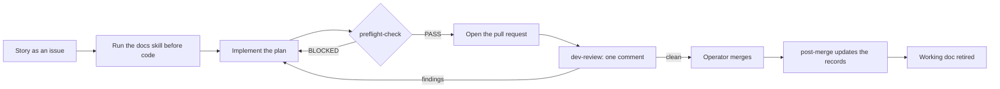

# checkrein

Reins and checks for coding agents.

checkrein is a workflow for coding agents: a hub document, a small set of living documents, ten skills, one manifest, a set of mechanical checks, and, in Claude Code, hooks that enforce the hub's hardest rules at the moment an agent acts. It was extracted from a method a solo developer ran for hundreds of pull requests on a production app, then generalized so any project on any stack can adopt it. It is MIT licensed and free.

## Why this works

A coding agent does not fail at random. It fails in a handful of predictable ways, and it repeats them, because it starts every session without memory of the last one. That predictability is the opening: if a failure is predictable, a counter can be placed at the exact moment the failure would happen. The counter does not need to be clever. It needs to be cheap and it needs to run at the right time.

checkrein is built on six ideas.

**One record per kind of knowledge.** Why the system is built this way lives in the architecture record. What the rules are lives in the business rules record. What exists right now lives in the state document. What went wrong lives in the corrections log. What changed lives in the changelog. Each fact has one home, and every other document links to it instead of restating it, because a restated fact is a second copy that drifts the moment the first one changes. These documents are the memory the agent does not carry between sessions.

**Every procedure reads before it acts and writes after.** A skill that writes code reads the corrections log first. A skill that reviews code reads the settled decisions first. A skill that runs after a merge writes what was learned back into the records. The loop closes on itself: what one session learns, the next session reads. A session that never reads the log reintroduces the bug last week's session fixed.

**Checks beat prose.** A rule written in a document is advice. A rule a script enforces is a fact. Wherever a rule can be checked mechanically, checkrein checks it: the corrections-log heading grammar, the state document's shape, working-doc names, cited paths that must exist. A corrections heading written without its tag drops out of the grep index and the rule is never found again; the check fails it on the next run. Where a rule cannot be checked, the hub states it once and every skill points back to that one statement, so there is never a second wording to disagree with.

**Reading is scaled to the change.** The `docs` skill has a tier gate. A prose edit reads almost nothing; a surgical code edit reads a little; new surface (a new module, endpoint, model or library) reads the full fan-out. Discipline that costs the same on a typo as on a new subsystem gets skipped. Discipline that costs almost nothing on small work and pays on large work gets kept.

**The templates carry their own instructions.** Every document the kit installs opens with a contract: what belongs in it, what never belongs in it, who writes it, and how agents read it. Below the contract, filler guidance names each section's purpose and gives a neutral example. An empty template produces a document nobody knows how to maintain, and within a few weeks it becomes a dumping ground that agents stop trusting. A document that says what it is for stays itself, because every agent that edits it reads the contract first. The reference-documentation tree works the same way: each folder is fronted by an `_INDEX.md` that tells the agent which file to open for which question, so a vendored library doc is read in the right place instead of in full or not at all. The kit keeps these templates and their filler current: when a skill starts reading or writing a section, the template and its guidance change in the same release.

**The operator stays in charge.** Merges, decisions, production access and anything irreversible belong to the operator, the human who owns the repository. Skills ask about those; they do not act on them. An agent that is never allowed to merge cannot merge the wrong thing.

### Each failure, and the counter that stops it

| Failure | What it looks like | The counter |
|---|---|---|
| Hallucinated API | The agent calls a function signature the library never had, because it looked plausible. | The `docs` skill runs before any code. It reads the vendored `_INDEX.md` for the library first and opens the file the index points to, so the agent works from the pinned version's real API instead of memory. |
| The repeated mistake | A bug fixed last month comes back in a new file, written by an agent that never saw the fix. | Before any code, the agent searches the corrections log's tagged headings (`### Pattern [domain]: ...`), scans every heading line, and pulls the matching entries by line number. A rule in the log is a hard constraint. |
| The relitigated decision | A reviewer flags a shape that was chosen on purpose three pull requests ago, and the operator pays for the same decision twice. | Part 4 of the state document (accepted debt and settled decisions) is read before any finding is written. An observation that matches a Part 4 row is not a finding; reopening one takes new evidence the row does not already contain. |
| Scope creep | A ticket about search also refactors the settings page because it "looked wrong". | Every observation about code the pull request did not touch ends in one of three dispositions: **Fold** (fix it now, only if certain, small and inside code the PR already changes), **Record** (one row in Part 4, or a rule in the business rules or architecture record), or **Drop** (one line in the review saying why). Nothing else. |
| Comment essays | A forty-line comment defends a clever mechanism to future reviewers. | Comment discipline treats a long comment as a symptom. The detail moves to its home document (behavior to business rules, rationale to architecture, anti-patterns to the corrections log) before the comment is shortened, and the code keeps only what it cannot express itself. |

### The honest limit

The method is text and checks. Text does not stop an agent that ignores it. The adopter check verifies the records after the fact; it cannot see whether an agent read the corrections log before editing, or whether it opened a folder it was told to leave alone.

That is still worth a great deal, for two reasons. First, the agents in common use are cooperative: they read the instruction files their harness loads and they follow procedures they are given. The failures above happen because the right information was not in front of the agent at the right moment, not because the agent was defiant, and putting the information in front of it is most of the fix. Second, the checks catch the drift that remains. A document that slides out of shape fails the next run of the check, so the records stay trustworthy enough to keep being read.

Release 0.2.0 adds enforcement at the moment an agent acts, for the one harness that exposes the hooks to do it: guards that deny or ask before a tool call runs, and a check at the end of a turn. Elsewhere, git hooks and CI catch what reaches a commit. [Enforcement (Claude Code)](#enforcement-claude-code) below says what each guard does and what it cannot see. The guards narrow the gap; they do not close it, and the hub's rules still carry the weight.

## The loop

One ticket, start to finish:

1. **Story.** `github-story-writer` turns a spec or plan into a GitHub issue with acceptance criteria, verification steps, the corrections warnings that apply, and the governing rules. A larger piece of work also gets a working doc: `plan - <descriptor>.md` in the working docs folder.
2. **Docs before code.** The implementing agent runs `docs`, which applies the tier gate, the corrections check and the Governing-Docs Check, then follows the plan task by task.
3. **Preflight before the pull request.** `preflight-check` runs the manifest's commands verbatim, scans the changed files against the corrections log, and ends in PASS or BLOCKED. No pull request until PASS.
4. **One consolidated review.** `dev-review` posts a single review comment per round. Every finding is classified, carries a confidence and a source, and clears the confidence floor. Later rounds verify fixes and widen nothing.
5. **The operator merges.** Always the operator, never the agent.
6. **Post-merge.** When the operator asks, `post-merge` closes the issue with completion notes, appends corrections entries and a changelog entry, moves the state document's currency marker, and retires the working doc.



`structured-debugging` governs any fix along the way, and `package-upgrade` governs any dependency change.

## Requirements

- Node 20 or newer, for the adopter check, the diff check and the Claude Code guards.
- git.
- A repository hosted on GitHub.
- The `gh` CLI, installed and authenticated, for the issue, pull request and review operations in `github-story-writer`, `dev-review` and `post-merge`.

The manifest's `project.tracker` is `github`, the only supported value in tier 1.

## Install

### Claude Code

Add the marketplace, then install the plugin:

```
claude plugin marketplace add a2zarslaan/checkrein
claude plugin install checkrein@checkrein
```

On recent builds, one step does both:

```
claude plugin install checkrein --marketplace a2zarslaan/checkrein
```

Inside a session:

```
/plugin marketplace add a2zarslaan/checkrein
/plugin install checkrein@checkrein
```

To try a local checkout without installing it, start Claude Code with the folder as a plugin, and run `/reload-plugins` after each edit:

```
claude --plugin-dir /path/to/checkrein
```

Once installed, the skills run by name, or explicitly as `/checkrein:<skill>`, for example:

```
/checkrein:init
/checkrein:preflight-check
```

### Other harnesses

checkrein is also a plain folder. Clone the whole checkrein repository and keep the clone, then either point your harness's skills location at the clone's `skills/` folder, or copy the skills elsewhere and run the `init` skill, giving it the clone's path when it asks for the checkrein folder. `init` needs the clone because it copies `templates/`, `scripts/checkrein-check.mjs` and `guards/diff-check.mjs` from it; a `skills/` folder copied on its own does not carry them. You can also copy the contents of `templates/` and `scripts/checkrein-check.mjs` into your repository root by hand, and `guards/diff-check.mjs` as `checkrein-diff-check.mjs` for the git hooks and CI.

The hub is `AGENTS.md`. Codex, Cursor and Copilot read `AGENTS.md`; Gemini CLI reads it through its context-file setting. Claude Code reads `AGENTS.md` natively from version 2.1.277, only when no `CLAUDE.md` exists in the directory or its parents, unless the operator sets the instruction-files option to read both. For that reason `init` also installs a `CLAUDE.md` whose one import line, `@AGENTS.md`, loads the hub even where a `CLAUDE.md` already exists.

## Set up a repository

From the repository root, run the `init` skill (in Claude Code, ask for it by name: "set up checkrein in this repo").

It copies, never overwriting an existing file:

- `templates/project-documentation/` to `project-documentation/`
- `templates/reference-documentation/` to `reference-documentation/`
- `templates/AGENTS.md` to `AGENTS.md` (if a hub already exists, it writes `AGENTS.checkrein.md` and appends a pointer section for you to merge)
- `templates/CLAUDE.md` to `CLAUDE.md` (if one exists, it appends the import line instead)
- `templates/checkrein.json` to `checkrein.json` (manifest version 2, the switch the Claude Code guards look for)
- `scripts/checkrein-check.mjs` to `checkrein-check.mjs`
- `guards/diff-check.mjs` to `checkrein-diff-check.mjs`
- `templates/.githooks/pre-commit` and `templates/.githooks/pre-push` to `.githooks/` (an existing hook of the same name is kept, and `init` gives you the line to add to it)
- `templates/.github/workflows/checkrein.yml` to `.github/workflows/checkrein.yml`, with its branch set to your trunk

It infers what it can from your package and workspace configuration (project name, trunk branch, lint, typecheck, test, build and format commands, example files, source folders) and shows where each value came from. Then it asks you, in one message, for what it cannot infer: your workspaces, your areas, any corrections domains to add, any protected trees, a release branch if you promote trunk to one, the production markers (host names, logins, ports and database URL patterns, never a credential), which actions ask for approval, and whether a code edit without a corrections read blocks or warns. It writes the manifest and an `.ignore` file that lists every protected tree and the reference tree, then runs the check:

```
node checkrein-check.mjs
```

Last, it prints the line that enables the git hooks, which you run yourself once per clone (`init` never changes git configuration):

```
git config core.hooksPath .githooks
```

In Claude Code it also tells you to install or update the plugin to 0.2.0 or later and to start a new session, so the hooks load. A fresh install prints `checkrein-check: OK (7 checks)`. `init` commits nothing; review the diff and commit it yourself. Then fill in the templates, starting with the project brief, replacing each guidance line with your own text and keeping the headings.

A repository set up with release 0.1.0 has a version 1 manifest. Run the `upgrade` skill to move it to version 2: it adds the new keys and changes no existing one, copies the enforcement files without overwriting, and prints the same lines. A version 1 manifest keeps working as before, with no enforcement.

## What is in your repository after init

### The documents

| Document | Purpose | Maintained by |
|---|---|---|
| `AGENTS.md` | The hub: a navigation map of where each kind of knowledge lives and which skill runs when. Holds no content a living document owns. | The operator |
| `CLAUDE.md` | One import line that loads the hub in Claude Code, plus a short Claude Code note. | The operator |
| `checkrein.json` | The manifest: every project-specific path, command, workspace and vocabulary. | `init` writes it once; the operator edits it after |
| `project-documentation/project-brief.md` | What the product is, who it serves, priorities, constraints, non-goals, glossary. | The operator |
| `project-documentation/architecture.md` | Why the system is built this way: decisions, mechanisms, revisit conditions. | Whoever makes the decision, in the same change; `post-merge` cross-checks it |
| `project-documentation/business-rules.md` | What the system does: lifecycles, cascades, gating, calculations. | The operator; `post-merge` cross-checks it |
| `project-documentation/corrections-log.md` | Anti-patterns as rules, indexed by tagged headings, newest first, append-only. | `post-merge` |
| `project-documentation/current-project-state.md` | What exists now, in four parts: structural inventory, delta log, open gaps, accepted debt and settled decisions. | `post-merge`, on every run |
| `project-documentation/CHANGELOG.md` | What changed, one section per merged pull request. | `post-merge` |
| `project-documentation/temp/` | Working docs: `plan - <descriptor>.md` and `audit - <descriptor>.md`, disposable by design. | Created when work starts; retired by `post-merge` |
| `project-documentation/runbooks/` | Operational procedures: deploy, rollback, setup. | The operator |
| `reference-documentation/` | Vendored library and pattern docs, read-only, each folder fronted by an `_INDEX.md`. Ships with a placeholder example folder showing the shape. | The operator; agents may edit only the `_INDEX.md` files |

Each template's opening comment is its contract. Keep it: it is what tells the next agent what the document is for. The check ignores HTML comments, so the contract costs nothing at check time.

Keep both folders even while they are thin. An empty `reference-documentation/` with its root `_INDEX.md` still tells every agent where vendored docs would be, so the first library you vendor lands in the right place with an index in front of it. A nested `CLAUDE.md` in that tree reminds Claude Code, on every read beneath it, that nothing there is a project instruction.

### The enforcement files

| File | Purpose |
|---|---|
| `checkrein-diff-check.mjs` | The diff check: one zero-dependency file the git hooks and CI run over staged changes or a commit range. |
| `.githooks/pre-commit`, `.githooks/pre-push` | Run the diff check before a commit and before a push, once `git config core.hooksPath .githooks` is set. |
| `.github/workflows/checkrein.yml` | Runs the adopter check and the diff check on every pull request to the trunk. On another CI, run its two commands there and delete it. |
| `.ignore` | Lists every protected tree and the reference tree, so `rg` and the search tools built on it skip them in a repository-wide search. Keep it in step with `protected_trees`. |

The Claude Code guards are not copied into your repository. They are the plugin's hooks, and they read your manifest on every call.

### The manifest

| Key | What it holds |
|---|---|
| `checkrein.manifest_version` | The manifest format version: 2 switches on enforcement, 1 keeps the method as text plus checks. |
| `project` | Name, one-line description, and the tracker (`github`). |
| `vcs` | The trunk pull requests target, and an optional release branch. |
| `commands` | Lint, typecheck, test, build and format-check commands, run verbatim by `preflight-check`; an empty one is reported as not configured. |
| `paths` | Where each living document and folder lives, relative to the repository root. |
| `workspaces` | The independently buildable parts of the repository, each a name and a root. |
| `protected_trees` | Folders an agent never reads as guidance, such as an archive of retired code. |
| `secret_globs` | Files an agent never reads or edits. |
| `domains` | The closed vocabulary for corrections-log tags; `process` is always present. |
| `areas` | The vocabulary for issue, pull request and branch names. |
| `review.confidence_floor` | The minimum confidence (0 to 100) a review finding needs to be posted. |
| `production_markers` | Version 2. Hosts, logins, ports and database URL patterns that identify production. |
| `example_globs` | Version 2. Secret-looking files an agent may read because they hold no real values. |
| `approval` | Version 2. Which actions ask first (push, pull request create, pull request merge, dependency change) and extra dependency command prefixes. |
| `consulted` | Version 2. Whether a code edit without the reads blocks or warns, the globs that count as code, and extra files to read beyond the corrections log. |

The version 2 keys are optional; a missing one takes its default. Skills cite manifest values as `{{ref:<dotted.key>}}` tokens and resolve them in their first step. Nothing project-specific is written into a skill. `skills/init/references/manifest-fields.md` describes every key in full.

## Skills

| Skill | Runs when | Produces |
|---|---|---|
| `init` | Once per repository, when there is no manifest yet | The templates, a version 2 manifest, the check script and the enforcement files in the repository root, nothing overwritten, then a check run and the git hooks line |
| `upgrade` | Once, in a repository whose manifest is version 1 | The version 2 keys added to the manifest (no existing key changed), the enforcement files copied without overwriting, the `.ignore` file, the git hooks and plugin update lines, then a check run |
| `docs` | Before writing or changing any code, proposing an approach, or attempting a fix | A file resolution table, the tier and why, the indexes and files read, the corrections rules that apply, the governing sections read |
| `dev-code` | Only when the operator asks for it | A posture for the task: think before coding, simplicity first, surgical changes, goal-driven execution |
| `github-story-writer` | When the operator wants a spec or plan broken into work | GitHub issues written like stories, grounded in the state document; a batch is shown for confirmation before it is created |
| `preflight-check` | Before every pull request | One report ending in PASS, or BLOCKED with a numbered list of critical failures |
| `dev-review` | Right after a pull request is created, and for each re-review | One consolidated review comment with classified, sourced findings above the confidence floor |
| `structured-debugging` | When a cause is not obvious, and always after a first fix fails | Triage, observation, documentation and diagnosis blocks, then a fix proposal; options for the operator on an Approach Limitation |
| `post-merge` | Only when the operator asks, after one or more merges | Issue completion notes and closure, corrections and changelog entries, an updated state document, the working doc retired |
| `package-upgrade` | Before any dependency version change, patch bumps included | A migration plan the operator approves, an exact-pinned upgrade with every pin location bumped in one commit, verification, a summary |

Every skill that reads project files begins with Step 0: read `checkrein.json`, substitute its tokens, and stop with a message to run `init` if it is missing.

## Mechanical checks

### For adopters: `checkrein-check.mjs`

One zero-dependency file, copied to your repository root by `init`. Run it with `node checkrein-check.mjs`; `--root <dir>` checks another folder and `--quiet` prints findings only. It exits 1 on any failure and 0 otherwise, with one line per finding prefixed by the check's name. It runs seven checks, in order:

1. **manifest**: `checkrein.json` parses, has every key and no unknown ones, `manifest_version` is 1 or 2 (each version 2 key that is present has the right shape, and in a version 1 manifest those keys are unknown), the trunk is named, every path exists (folders written with a trailing slash), `domains` includes `process`, every workspace has a unique name and a root that exists, and the confidence floor is an integer from 0 to 100.
2. **corrections**: every rule heading follows `### Pattern [<domains>]: <sentence>` or `### Convention [<domains>]: <sentence>`, every tag is in `domains`, and every entry carries its four fields in order: What went wrong, Correct approach, Rule, Files affected.
3. **working-docs**: every markdown file in the working docs folder is named `plan - <descriptor>.md` or `audit - <descriptor>.md` (a README is allowed).
4. **state-doc**: the currency marker line `Current as of: <merge commit or description>` comes before the first part, and the four Part headings appear exactly once each, in order, and no other heading starts with "## Part".
5. **changelog**: subsection headings sit inside a section and are only Added, Changed or Fixed. An empty subsection or a section with none is a warning, not a failure.
6. **em-dash**: no em dash in the docs folder, the hub, `CLAUDE.md` or the manifest.
7. **cross-refs**: every backticked repository path in the hub and the docs folder exists. Placeholders, commands, URLs and patterns are skipped.

### For adopters: `checkrein-diff-check.mjs`

One zero-dependency file, copied to your repository root by `init` or `upgrade` from `guards/diff-check.mjs`. The git hooks run `node checkrein-diff-check.mjs --staged` before a commit and `--range <base>..<head>` over the commits each push adds; CI runs it over the pull request's range from the merge base with the trunk. It reads `checkrein.json`, prints one line per finding, and exits 1 on any failure:

- **Fails** on a file matching `secret_globs` (and no `example_globs` entry) that is added or modified, and on a file inside a protected tree that is modified, deleted or moved out. A rename is read as a delete plus an add, so moving a file out of a protected tree fails as a delete. Adding a file into a protected tree is retirement and passes.
- **Warns**, never fails, on added lines in text files that name a production host, login or database URL pattern, because runbooks legitimately name hosts. Ports are not checked in a diff.
- With no manifest or a version 1 manifest it exits 0 with one line saying it is off. A manifest that does not parse fails.
- The git hooks skip the check, with a one-line hint and without blocking, when `node` is not installed or `checkrein-diff-check.mjs` is missing from the repository root. CI is the backstop.

### For contributors: `scripts/repo-checks.mjs`

Holds this repository to the same hygiene it asks of adopters. Run `node scripts/repo-checks.mjs`; it checks:

- **em-dash**: no em dash in any file.
- **leaks**: no term from the private, gitignored term list appears anywhere.
- **skills**: every skill folder has a `SKILL.md` under 500 lines with portable frontmatter, a name equal to the folder name, and a description of 1 to 1024 characters.
- **skill-refs**: every backticked path a skill cites exists.
- **plugin**: both plugin manifests parse, the plugin is named checkrein, and the marketplace entry matches it.
- **manifest-template**: `templates/checkrein.json` matches the manifest contract exactly.
- **readme**: the skills table in this file lists every skill folder and nothing else.
- **hooks**: `hooks/hooks.json` parses, every hook has a timeout, and every plugin file it names exists.
- **guards**: `guards/cases.json` holds at least 100 complete cases, and every guard module has its test file.
- **versions**: `.claude-plugin/plugin.json` and `package.json` carry the same version, and `CHANGELOG.md` has a section for it.
- **templates**: the adopter check passes on `templates/` as if it were a fresh repository.

`node --test scripts/*.test.mjs guards/*.test.mjs` runs the tests for the check scripts and the guards, the case file included. The files in `guards/rules/` have no test files of their own, and `guards/pretooluse.mjs` is tested by `guards/cases.test.mjs` through the case file.

## Enforcement (Claude Code)

The plugin ships hooks (`hooks/hooks.json`) that run the scripts in `guards/` before every shell command and every file read, edit and search, and once at the end of every turn. They turn four of the hub's rules into decisions on the tool call itself. A denial reaches the agent as the reason for that one call, naming what was denied and the allowed alternative; the session goes on. Inside one call the first rule that fires decides, in the order of the table. When no rule fires, the guards print nothing, so your permission settings and prompts decide exactly as they would without the plugin.

| Guard | What it watches | What it does | What it cannot see |
|---|---|---|---|
| Production access | Every shell command | Denies an SSH-family client in command position (`ssh`, `scp`, `sftp`, `rsync`, `autossh`, `sshpass`, `mosh`, `ssh-copy-id`, `telnet`, also behind `sudo`, `env` and similar wrappers or an absolute path), an `ssh://`, `scp://` or `sftp://` address, and any production host, login, port or database URL pattern from the manifest. A listed host also matches its subdomains. The reason tells the agent to diagnose on a local copy and hand you a single-line command. | A host or command assembled from variables at run time; a script written now and run later; a connection a program opens by itself (a test, a database client library); any tool other than the shell; a production host you did not list. |
| Protected trees | Shell commands, and the file tools' paths | Denies reading a folder in `protected_trees`: a file tool aimed inside one, a Grep or Glob whose path or glob names one, a shell segment that names one with any command outside the metadata and retirement list (`ls`, `find` without an executing action, `test`, `stat`, `du`, `wc`, `mkdir`, `echo`, `printf`, `gh`, git `log`, `add`, `rm`, `commit`, `status`, `restore` and `diff --stat`, and an `mv` into a tree), a reader fed from one through a pipe or a substitution, an `mv` whose source is inside one, and a recursive `grep` from the repository root or a parent. Off when `protected_trees` is empty. | A search that names no path (the `.ignore` file keeps `rg` out instead); a symlink made in an earlier command; a path assembled from variables or spelled by glob or brace expansion; a program that opens the files itself. |
| Secret files | Shell commands, and the file tools' paths | Denies reading or writing a file that matches `secret_globs` and no `example_globs` entry: a file tool on it, a Grep whose path is one, a redirection into or out of one, and a shell segment that passes one to a reader, an editor, `source` or `.`. Listing and metadata commands are allowed, and Glob is allowed because it lists names only. | A program that loads the file itself (a test runner, a framework that reads an environment file at start); a path assembled from variables; a secret kept in a file no glob names. |
| Approval | Every shell command | Asks you before each class listed in `approval.ask`: a `git push` in any form, `gh pr create`, `gh pr merge`, a mutating `gh api` call on pulls, merges, refs or contents (review and comment endpoints excepted) or a GraphQL mutation, and a dependency change (the common JavaScript, Python, Rust and Go add, remove, update and re-resolving install commands, plus `approval.dependency_commands`). A lockfile-faithful install never asks. It asks; it never denies. | The same action through a script, an alias, a task-runner target or a tool other than the shell; a package manager not built in and not listed. |
| Consulted evidence | The end of every turn | When the turn edited a file matching `consulted.code_globs` through the file tools, it looks through the session transcript for a read of the corrections log and of each `consulted.required_reads` file: a Read, a Grep whose path names it, or a shell command that names it beside a reader (`cat`, `sed`, `head`, `tail`, `grep`, `rg`, `awk`, `less`). With none, it blocks the end of the turn once and names the files (`consulted.mode` `warn` shows a warning instead); the second stop always passes, so it cannot loop. | Edits made through shell commands (reads made through them are seen); edits a subagent makes; whether the read was understood or happened in this turn (a read earlier in the session counts); a transcript the harness has not written yet, or one that is empty or unreadable (the check stays silent rather than block falsely). A manifest error blocks the end of the turn once, with the message. |

**Activation.** The guards act only in a repository whose `checkrein.json` says `manifest_version` 2 or higher. With no manifest, or a version 1 manifest, every hook stays silent and decides nothing, so installing the plugin changes nothing in a repository that has not opted in. `init` writes version 2; the `upgrade` skill moves a version 1 manifest to version 2. The hooks load at session start, so after installing or updating the plugin (`claude plugin update checkrein`) start a new session. The plugin's install pane lists the hooks it adds. A manifest that does not parse, or a guard that fails internally, does not fail open: every tool call asks you, with the error text, until the manifest is fixed, and the end-of-turn check blocks once with the error.

**The deliberate read.** A shell command that starts with `CHECKREIN_ALLOW_PROTECTED=1` lifts the protected-tree rule for that one command and no other rule. The hub tells the agent never to set it on its own initiative: you name the path, and the agent runs the read through the shell with the prefix. The file tools have no such prefix.

**Other harnesses.** checkrein's guards run only in Claude Code; in other harnesses the git hooks and CI run the diff check. They catch what reaches a commit: a secret file added, a protected tree changed, a production host written into a tracked file (as a warning). They never catch a read, a live connection, or anything an agent does that produces no commit. A commit made with the hooks skipped (`--no-verify`) is caught by CI on the pull request.

**Honest scope.** The guards are a guardrail for cooperative agents, not a security boundary. They match command text, so a lexical matcher is defeated by a path assembled from variables, a symlink made in an earlier command, or a script written now and run later. The hub's rules are what stop an agent that tries; the harness sandbox is the operating-system boundary. Use all three.

## Limits

checkrein does not:

- Stop an agent that ignores the hub and works around the guards. The guards read command text; the checks run after the fact.
- See edits made through shell commands at the end of a turn. The consulted-evidence check sees edits made through the file tools only, and a read made through the shell counts only when the command names the file beside a reader.
- Block on a lagging transcript. The harness writes the transcript asynchronously; when it is missing or empty at the end of a turn, the check allows.
- Enforce anything at the moment an agent acts outside Claude Code. Other harnesses get the commit-time checks only: the git hooks and CI.
- Ship stack knowledge: no per-stack review checklists, preflight rules or upgrade notes. Stack-specific facts go in your manifest and your own documents.
- Vendor any library's documentation. The reference tree describes how to vendor and index; what goes in it is yours.
- Run anything hosted. There is no service, no account, no telemetry and no network call from any script or hook.

## Roadmap

The full plan is in [the three-tier roadmap](docs/plans/three-tier-roadmap.md).

**Tier 1, the method as text plus checks.** The hub, the document templates with their filler guidance, the reference tree template, every skill except `upgrade`, the manifest and the adopter check.
Released as 0.1.0, packaged as a Claude Code plugin and as a plain folder.
The templates are maintained with the skills: when a skill's reads or writes change, the template changes in the same release.

**Tier 2, enforcement for Claude Code.** Version 0.2.0: the guards and the end-of-turn check described in [Enforcement (Claude Code)](#enforcement-claude-code), the `upgrade` skill, and the diff check with its git hooks and CI workflow for every harness.
One evaluator, zero dependencies, fail closed, and a case file of allow, ask and deny cases run as tests.
The guards are free, inside this plugin; the roadmap records why.

**Tier 3, packs and adapters.** Stack packs with docs routing, review checklists, preflight rules as data with fixtures, upgrade notes, and corrections compiled to lint rules.
Adapters for harnesses without skills, glob-scoped rule files for editors, and a conformance suite every adapter must pass.
Each pack or adapter is its own release.

**The demand rule.** Tier 3 work, a single pack or adapter at a time, starts only after three distinct asks from different people or teams, in their own words. The same rule governs shipping 0.2.0 to the official plugin directory, unless the roadmap's recorded decision says otherwise. Stars, forks and downloads do not count, and the projects checkrein is developed in do not count as an ask.

## Contributing

See [CONTRIBUTING.md](CONTRIBUTING.md) for setup, the rules every change follows, how to add a skill, and how to test the adopter flow in a scratch repository.

## License

MIT. See [LICENSE](LICENSE).
